<!-- ═══════════════ HEADER ═══════════════ -->
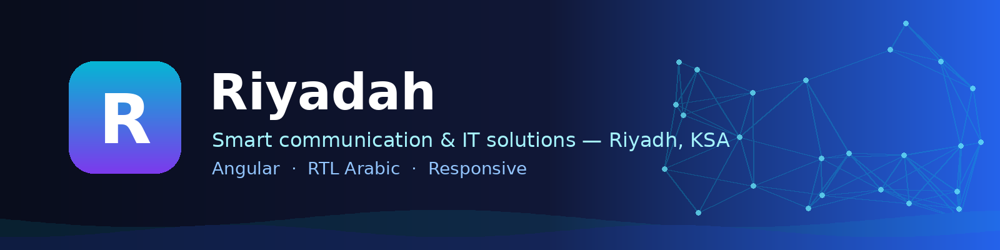

<div align="center">

<a href="https://www.riyadah-ksa.com/"></a>


<br/>

**A modern, single-page company website for Riyadah (ريادة), a Saudi provider of call-center, VoIP and IT solutions.**

[Overview](#-overview) · [Highlights](#-highlights) · [Sections](#-page-sections) · [Screenshots](#-screenshots) · [Tech](#%EF%B8%8F-tech-stack) · [Contact](#-contact)

</div>

---

## 🌐 Overview

**[riyadah-ksa.com](https://www.riyadah-ksa.com/)** is the official website of **Riyadah**, a technology company in **Riyadh, Saudi Arabia**. Riyadah delivers **call-center systems (Vici Dialer), VoIP, ticketing (Issuable), network infrastructure, cyber security, AI, cloud and software solutions**.

The site is built as a fast **Angular single-page application** with a **dark, glowing blue–cyan design** and full **Arabic right-to-left** layout. It tells the company's story from first impression to contact, and turns visitors into leads through clear calls to action, WhatsApp and one-tap calling.

<table>
<tr>
<td align="center" width="25%">🎨<br/><b>Modern design</b><br/><sub>Dark theme, gradients, glow effects</sub></td>
<td align="center" width="25%">⚡<br/><b>Fast SPA</b><br/><sub>Angular 21, smooth in-page navigation</sub></td>
<td align="center" width="25%">📱<br/><b>Responsive</b><br/><sub>Works on phones, tablets and desktops</sub></td>
<td align="center" width="25%">💬<br/><b>Lead-focused</b><br/><sub>WhatsApp, call and email always one tap away</sub></td>
</tr>
</table>

---

## ✨ Highlights

<table>
<tr>
<td width="50%" valign="top">

### 🧭 Navigation & UX
- **Sticky header** with the active section highlighted while scrolling
- **Scroll progress bar** under the header
- **Top info bar** with phone numbers and emails
- **Back-to-top** button
- Smooth scrolling between sections

</td>
<td width="50%" valign="top">

### 📞 Conversion
- Floating **quick-contact buttons**: call, **WhatsApp**, email
- **"Request a consultation"** call to action in the header and through the page
- Contact section with address, phones, emails and **working hours** (Riyadh time)

</td>
</tr>
<tr>
<td width="50%" valign="top">

### ✨ Motion & visuals
- **Animated counters** (experience, clients, projects, uptime)
- Reveal-on-scroll cards
- Glowing gradient buttons and icon badges
- Floating technology chips in the hero (Cyber Security, CRM, AI, IoT, Cloud…)

</td>
<td width="50%" valign="top">

### 🏢 Trust building
- Company **CR and VAT numbers**
- **Leadership team** profiles
- **Timeline** of the company's journey (2008 → 2025)
- Client **testimonials** and featured projects
- **FAQ** with expandable answers

</td>
</tr>
</table>

---

## 🗂️ Page sections

| # | Section | What it shows |
|---|---|---|
| 1 | **Hero** | Headline, value proposition, CTAs, trust badges (security, 24/7 support, quality) |
| 2 | **Services** | 12 service cards: corporate solutions, network infrastructure, cyber security, ERP & CRM, AI, software, smart home, security systems, IT consultation, cloud, SharePoint, VPN |
| 3 | **Specialised systems** | Vici call-center system, Issuable ticketing, advanced VoIP, plus 24/7 support, security, updates and reports |
| 4 | **About** | Story, animated stats, mission, vision, values, company registration |
| 5 | **Leadership** | Founder & CEO, Head of Development |
| 6 | **Timeline** | Milestones from 2008 to 2025 |
| 7 | **Projects** | Project stats and featured projects |
| 8 | **Testimonials** | Client feedback |
| 9 | **Process** | 4 steps: analysis → design → testing → support |
| 10 | **Contact** | Office, phones, emails, working hours, WhatsApp |
| 11 | **FAQ** | Integration, security, AI and cloud questions |

---

## 📷 Screenshots

### 🖥️ Desktop

<table>
<tr>
<td width="50%">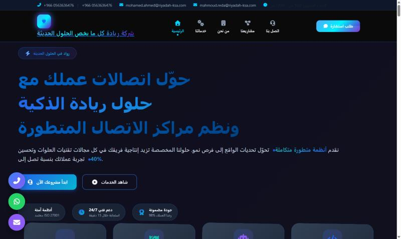<p align="center"><sub><b>Hero</b></sub></p></td>
<td width="50%">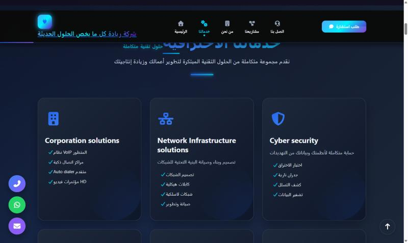<p align="center"><sub><b>Services</b></sub></p></td>
</tr>
<tr>
<td>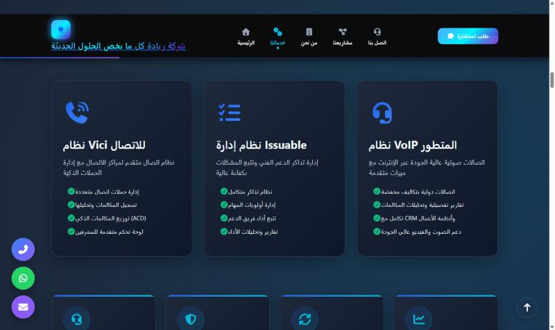<p align="center"><sub><b>Specialised systems</b>: Vici, Issuable, VoIP</sub></p></td>
<td>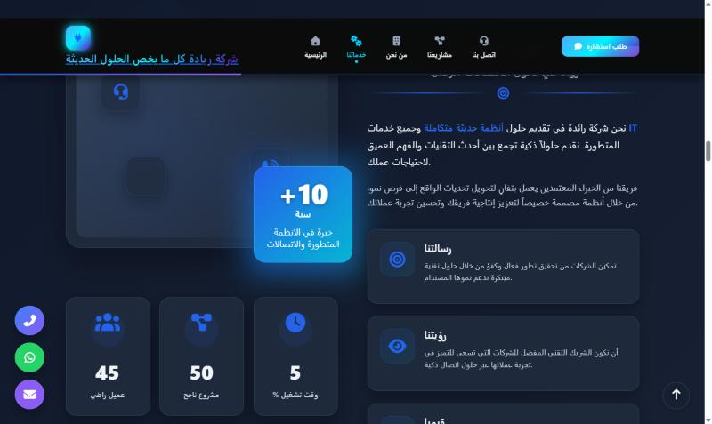<p align="center"><sub><b>About</b> with animated stats</sub></p></td>
</tr>
<tr>
<td>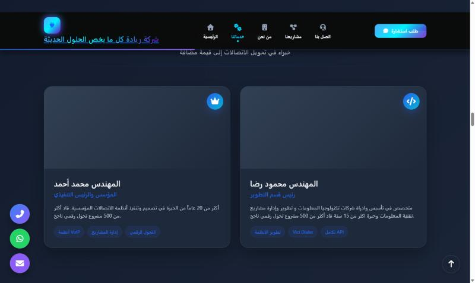<p align="center"><sub><b>Leadership team</b></sub></p></td>
<td>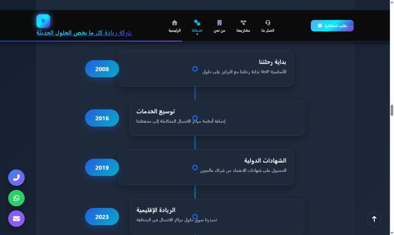<p align="center"><sub><b>Timeline</b></sub></p></td>
</tr>
<tr>
<td>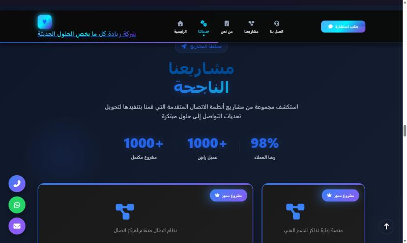<p align="center"><sub><b>Projects</b></sub></p></td>
<td>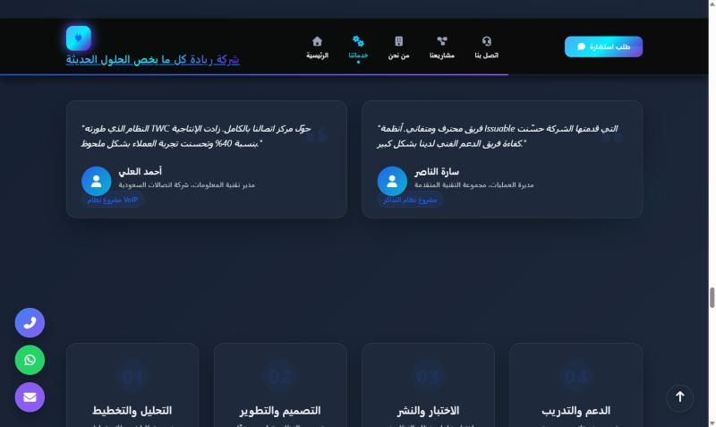<p align="center"><sub><b>Testimonials</b></sub></p></td>
</tr>
<tr>
<td>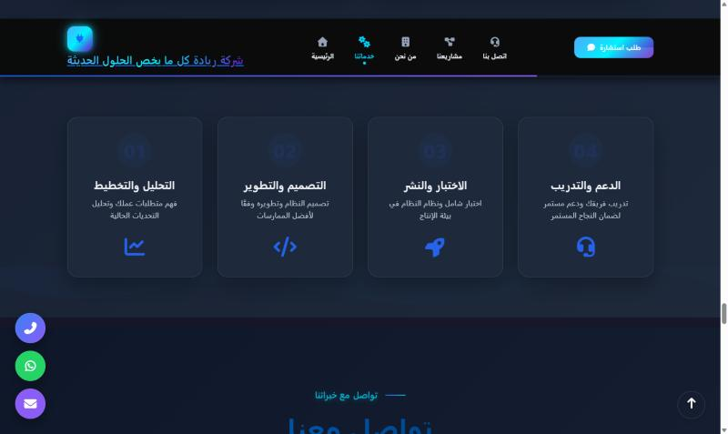<p align="center"><sub><b>Delivery process</b></sub></p></td>
<td>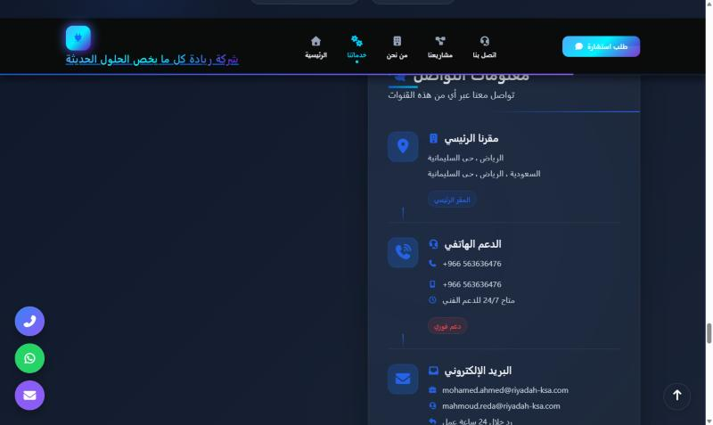<p align="center"><sub><b>Contact</b></sub></p></td>
</tr>
<tr>
<td>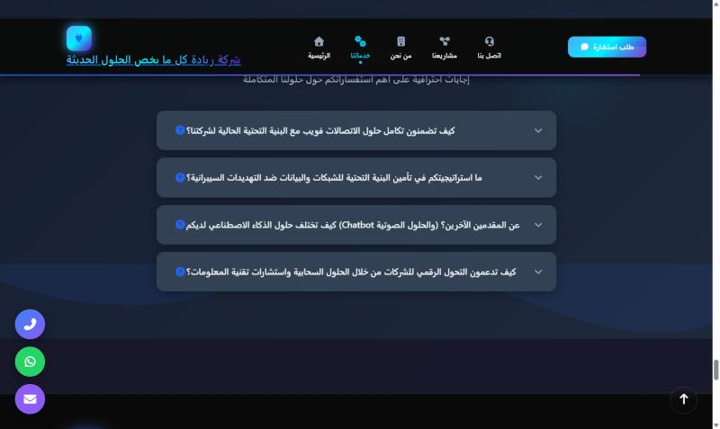<p align="center"><sub><b>FAQ</b></sub></p></td>
<td></td>
</tr>
</table>

### 📱 Mobile

<div align="center">
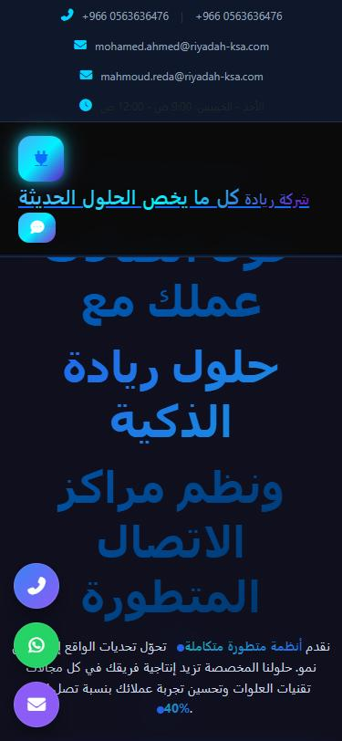
&nbsp;&nbsp;
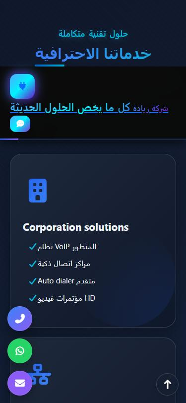
</div>

---

## 🛠️ Tech stack

| Part | Technology |
|---|---|
| Framework | **Angular 21** (standalone components, single-page app) |
| Language | **TypeScript** |
| Styling | **Bootstrap 5** + custom CSS (gradients, glow, animations) |
| Layout | **Arabic RTL**, responsive for mobile, tablet and desktop |
| Integrations | WhatsApp click-to-chat, `tel:` and `mailto:` links |

### Run locally

```bash
npm install
ng serve          # http://localhost:4200
ng build          # production build in dist/
```

---

## 📬 Contact

<div align="center">

<a href="https://www.riyadah-ksa.com/"></a>
<a href="https://www.linkedin.com/in/ahmed-toba-7378b0206/"></a>
<a href="mailto:ahmedtobashahban21@gmail.com"></a>

<br/><br/>

<sub>Designed and developed by <a href="https://github.com/ahmedtobashahban21">Ahmed Toba </a></sub>

</div>


